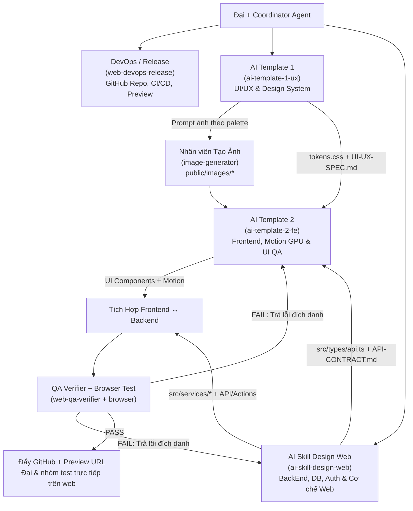

# Đội Quân AI Agent — Đồ Án Web Tốt Nghiệp

Tài liệu tổng hợp kiến trúc **"Đội Quân AI Agent"** đã được cấu hình trong workspace [d:/Dự án web tốt nghiệp](file:///d:/Dự%20án%20web%20tốt%20nghiệp) theo đúng phân công của Đại: **AI lo thiết kế/lập trình/QA/GitHub CI-CD, còn nhóm người thật của Đại phụ trách nghiên cứu dữ liệu đề tài & viết báo cáo đồ án.**

---

## 1. Sơ Đồ Phối Hợp Đội Quân (Từ Ý Tưởng $\rightarrow$ GitHub Live Check)

---

## 2. Hồ Sơ Từng Vai Trò Trong Đội Quân

### A. Nhánh Lập Trình & Thiết Kế Chuyên Trách (4 Custom Agents + 2 Built-in Tools)

| Tên Agent / Công cụ | Thuộc Plugin | Vai Trò & Nhiệm Vụ | Tài Liệu / Tri Thức Cốt Lõi |
|---|---|---|---|
| `ai-template-1-ux` | [`web-craft-studio`](file:///d:/Dự%20án%20web%20tốt%20nghiệp/.agents/plugins/web-craft-studio/plugin.json) | **AI Template 1** — UI/UX & Design System: Page Grammar, Feeling Curve, Taste Floor, màu 6 vai trò + 1 accent, `tokens.css`, wireframe/layout & chống trùng template | `design-grammar-and-taste.md`, `FINGERPRINTS.md`, Playbook Đợt 1→4 ([`README-TEMPLATE-PACK-1-TO-4.md`](file:///d:/Dự%20án%20web%20tốt%20nghiệp/docs/README-TEMPLATE-PACK-1-TO-4.md)) |
| `ai-template-2-fe` | [`web-craft-studio`](file:///d:/Dự%20án%20web%20tốt%20nghiệp/.agents/plugins/web-craft-studio/plugin.json) | **AI Template 2** — Frontend, Motion GPU & UI QA: dựng UI components/sections, GPU animation 60fps, Web API hiện đại & rà 8 cổng lỗi QA | [`modern-web-guidance`](file:///d:/Dự%20án%20web%20tốt%20nghiệp/.agents/skills/modern-web-guidance/SKILL.md), `frontend-techniques.md` (21 kỹ thuật Đợt 1→4), `scrollcraft.js`, `qa-bug-checklist.md` |
| `image-generator` *(built-in)* | Hệ thống Antigravity | **Nhân viên Tạo Hình Ảnh**: chạy theo quy trình 8 bước [`image-pipeline.md`](file:///d:/Dự%20án%20web%20tốt%20nghiệp/.agents/plugins/web-craft-studio/skills/web-craft-studio/references/image-pipeline.md) (`image-style.md`, `assets/anchor.webp`, bảng Bước 1, prompt 6 mục, hậu kỳ Python/OpenCV ra WebP, `assets/prompts.md`) | Chỉ sinh Hero, nền chiều sâu, 404/Empty State, banner; không sinh chữ trong ảnh; `hero < 300KB`, `card < 120KB` |
| `ai-skill-design-web` | [`web-skill-design`](file:///d:/Dự%20án%20web%20tốt%20nghiệp/.agents/plugins/web-skill-design/plugin.json) | **AI Skill Design Web** — BackEnd & Cơ chế Web bên trong: DB (Prisma/Postgres/Supabase), Auth/Session/RBAC, Route Handlers, Server Actions, Caching, Zod validation, Security & `src/services/**` | [`web-backend-architecture`](file:///d:/Dự%20án%20web%20tốt%20nghiệp/.agents/plugins/web-skill-design/skills/web-backend-architecture/SKILL.md), `nextjs-fullstack-patterns.md`, `database-auth-security.md`, `contract-and-council-defense.md` |
| `web-devops-release` | [`web-skill-design`](file:///d:/Dự%20án%20web%20tốt%20nghiệp/.agents/plugins/web-skill-design/plugin.json) | **DevOps & Release Engineer**: Git/GitHub workflow, `.github/workflows/ci.yml` (`tsc`, `lint`, `build`), Docker, `.env.example`, Preview Deploy (Vercel/Firebase/Cloud Run), Security Headers & SEO (`robots.ts`, `sitemap.ts`) | [web-devops-release.md](file:///d:/Dự%20án%20web%20tốt%20nghiệp/.agents/plugins/web-skill-design/agents/web-devops-release.md) |
| `web-qa-verifier` + `browser` | [`web-skill-design`](file:///d:/Dự%20án%20web%20tốt%20nghiệp/.agents/plugins/web-skill-design/plugin.json) | **QA Verifier & Visual E2E Tester**: kiểm tra code/build/bảo mật (read-only) + mở web kiểm thử trực quan Desktop/Mobile (`375px`) trước khi push lên GitHub | `qa-bug-checklist.md`, `database-auth-security.md`, `graduation-code-craft.md` |

*(Agent tổng hợp cũ [`web-craft-architect.md`](file:///d:/Dự%20án%20web%20tốt%20nghiệp/.agents/plugins/web-craft-studio/agents/web-craft-architect.md) vẫn được giữ lại cho tác vụ nhỏ đơn lẻ.)*

### B. Nhánh Nhóm Người Thật (Ngoài AI Agent)
- **Thành viên nhóm Đồ án của Đại:** Đảm nhận **nghiên cứu dữ liệu đề tài, thu thập nội dung thực tế và viết báo cáo / slide bảo vệ hội đồng**. Đội AI Agent không lấn sang phần này mà chỉ cung cấp mã nguồn sạch và file đặc tả kỹ thuật (`UI-UX-SPEC.md`, `API-CONTRACT.md`, `prisma/schema.prisma`) để nhóm tham chiếu chính xác.

---

## 3. Phân Chia Thư Mục Sở Hữu (Tránh Xung Đột)

- **`ai-template-1-ux`**: `docs/UI-UX-SPEC.md`, `image-style.md`, `assets/anchor.webp`, `src/styles/tokens.css`, `src/styles/themes.css`, `FINGERPRINTS.md`
- **`ai-template-2-fe`**: `src/components/**`, `src/sections/**`, `src/motion/**`, giao diện trong `src/app/**/page.tsx` (render chữ/CTA HTML đè lên vùng trống, SVG/CSS icon, khung thiết bị cho screenshot thật)
- **`image-generator` + Hậu kỳ Python/OpenCV**: `public/images/[loai]-[vi-tri]-[so].webp`, `assets/prompts.md` (tuân thủ [`image-pipeline.md`](file:///d:/Dự%20án%20web%20tốt%20nghiệp/.agents/plugins/web-craft-studio/skills/web-craft-studio/references/image-pipeline.md))
- **`ai-skill-design-web`**: `docs/API-CONTRACT.md`, `prisma/**`, `supabase/**`, `src/types/api.ts`, `src/schemas/**`, `src/app/api/**`, `src/actions/**`, `src/server/**`, `src/lib/**`, `src/services/**`, `src/state/**`, `src/middleware.ts`
- **`web-devops-release`**: `.gitignore`, `.github/**`, `Dockerfile`, `docker-compose.yml`, `.env.example`, `vercel.json`, `apphosting.yaml`, `next.config.*` (headers/images), `src/app/robots.ts`, `src/app/sitemap.ts`, `src/app/api/health/route.ts`
- **`web-qa-verifier`**: Không sửa file — chỉ đọc và chạy kiểm chứng.

---

## 4. Quy Trình Nghiệm Thu Qua GitHub (Thực Chiến)

Mỗi khi hoàn thành xong 1 tính năng / cột mốc:
1. `web-qa-verifier` xác nhận `tsc`, `lint`, `build`, QA 8 cổng và Security đều **PASS** (có thể kèm `browser` test giao diện).
2. `web-devops-release` kiểm tra `.gitignore` / không lộ secret, tạo commit gọn theo milestone và **push lên GitHub repo** (hoặc tạo PR).
3. GitHub Actions chạy lại CI + tạo **Preview URL** (ví dụ qua Vercel kết nối repo GitHub) để **cả Đại, nhóm bạn và AI** đều mở thẳng link web kiểm tra kết quả thực tế.
