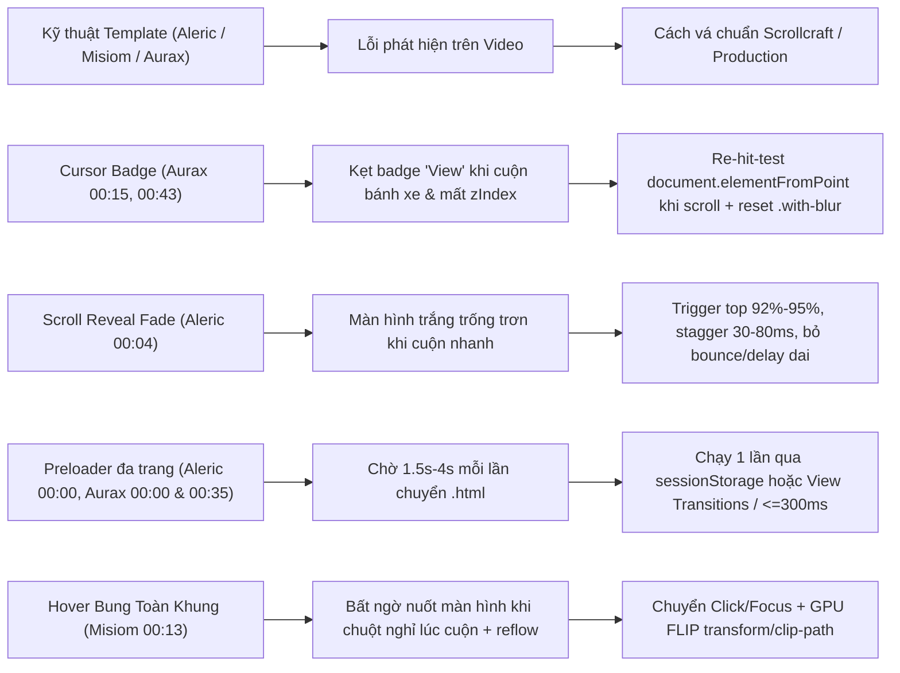

# Playbook Đợt 1 — UX/UI, Frontend & Kỹ Thuật "Flex" Từ 3 Mẫu Agency Portfolio

Tài liệu tổng hợp toàn bộ bài học thực chiến rút ra từ 3 mẫu trong Đợt 1 (`03_AGENCY_PORTFOLIO`):
1. **Mẫu 1 — `Aleric-Digital-Agency`** ([`blog-grid-light.html`](file:///d:/templates/03_AGENCY_PORTFOLIO/Aleric-Digital-Agency/blog-grid-light.html))
2. **Mẫu 2 — `Misiom-Branding-Marketing-Agency`** ([`index.html`](file:///d:/templates/03_AGENCY_PORTFOLIO/Misiom-Branding-Marketing-Agency/index.html))
3. **Mẫu 3 — `Aurax-Digital-Agency-Portfolio`** ([`index.html`](file:///d:/templates/03_AGENCY_PORTFOLIO/Aurax-Digital-Agency-Portfolio/index.html), [`portfolio-3-columns.html`](file:///d:/templates/03_AGENCY_PORTFOLIO/Aurax-Digital-Agency-Portfolio/portfolio-3-columns.html))

Mỗi kỹ thuật đều được đối chiếu với video quay màn hình thực tế, source code gốc và hệ chuẩn thiết kế của `scroll-craft` ([`taste.md`](file:///C:/Users/Phat%20Dai/.gemini/config/plugins/nateherk-design/skills/scroll-craft/references/taste.md), [`devices.md`](file:///C:/Users/Phat%20Dai/.gemini/config/plugins/nateherk-design/skills/scroll-craft/references/devices.md), [`uniqueness.md`](file:///C:/Users/Phat%20Dai/.gemini/config/plugins/nateherk-design/skills/scroll-craft/references/uniqueness.md), [`hero-depth.md`](file:///C:/Users/Phat%20Dai/.gemini/config/plugins/nateherk-design/skills/scroll-craft/references/hero-depth.md), [`approved-collection.md`](file:///C:/Users/Phat%20Dai/.gemini/config/plugins/nateherk-design/skills/scroll-craft/references/approved-collection.md)) để khi bắt tay làm **Dự án Web Tốt nghiệp** ta tái sử dụng được phần *tinh túy*, nâng cấp phần *kỹ thuật*, và né sạch *bẫy template*.

---

## Phần 1: Bản Đồ So Sánh UI & Nhịp Điệu Thị Giác (Visual Grammar)

| Trục thiết kế | Mẫu 1: `Aleric` (Blog Grid Light) | Mẫu 2: `Misiom` (Dark Bento Showcase) | Mẫu 3: `Aurax` (Editorial Lime + Brutal Type) | Bài học áp dụng Web Tốt nghiệp |
|---|---|---|---|---|
| **Palette & Tương phản** | Nền trắng sáng, chữ đen `#030303`, nhấn vàng chanh `#C4EE18` ở SVG nhỏ | Dark hero tương phản cao (`#000`/tối + cam nóng) xen kẽ section nền sáng (`About Company`, `Our Services`) | Giấy ấm `#f6f3ed` + mực `#121212` + acid lime `#c4ee18` xuyên suốt từ sub-heading tới `.default-btn` ([`common-style.css`](file:///d:/templates/03_AGENCY_PORTFOLIO/Aurax-Digital-Agency-Portfolio/assets/css/common-style.css)) | Khóa **1 hue accent** toàn trang; nếu lật light/dark giữa trang phải set lại cả `--sc-ink` lẫn `color: var(--sc-ink)` trên subtree ([`taste.md#L73-L102`](file:///C:/Users/Phat%20Dai/.gemini/config/plugins/nateherk-design/skills/scroll-craft/references/taste.md#L73-L102)). |
| **Bố cục (Layout Rhythm)** | Split hero (H2 trái + mô tả `mt-135` phải) → ảnh ngang full-bleed → lưới blog 3 cột đều | Bento hero tách lớp (khối 3D + nhân vật + 2 thẻ nổi) → About bất đối xứng → 4 cột Service → Carousel cột sọc bung toàn khung → Testimonials 2 cột (1 pin + 1 cuộn) | Hero `220px` display type + thumb phụ → Portfolio lệch tầng (staggered) → Service list scrub → Horizontal scroll 3 màn (`Team -> Awards -> CTA`) → Blog 3 kích cỡ (`medium` / `big` / `small`) | **Tuyệt đối không dùng 3 cột bằng nhau làm cấu trúc chủ đạo** ([`taste.md#L185-L194`](file:///C:/Users/Phat%20Dai/.gemini/config/plugins/nateherk-design/skills/scroll-craft/references/taste.md#L185-L194)). Học cách lệch tầng của `Aurax` và đối xứng pin-scroll của `Misiom`. |
| **Chiều sâu (Hero Depth)** | Ảnh banner phẳng gắn `data-speed="0.4"` + scale `1.15` | Phân lớp khá rõ: nền → vòng 3D xoay scrub → ảnh người cắt nền → 2 thẻ UI chồng trước ([`index.html#L164-L165`](file:///d:/templates/03_AGENCY_PORTFOLIO/Misiom-Branding-Marketing-Agency/index.html#L164-L165)) | `envato.gif` kẹp inline trong H1 + `.hero-thumb` & `.hero-shape` tách rời | Thay `gif` kiểu ThemeForest bằng ảnh/3D có **Layer Contract** (`far` → `mid` → `subject` → `foreground` → `atmosphere`) + chừa đáy che đường cắt bằng gradient fade ([`devices.md#L349-L368`](file:///C:/Users/Phat%20Dai/.gemini/config/plugins/nateherk-design/skills/scroll-craft/references/devices.md#L349-L368)). |
| **Chi tiết định danh (Brand Craft)** | Nút Back-to-Top có vòng SVG `strokeDashoffset` + sóng nước `.water_wave` ([`backtop.js#L36-L53`](file:///d:/templates/03_AGENCY_PORTFOLIO/Aleric-Digital-Agency/assets/js/backtop.js#L36-L53)) | Thẻ số thứ tự `01–04` lật tương phản hoàn toàn khi hover; `Case Studies` mở bung chiếm trọn sân khấu | Sticky `.work-portfolio-title-section` (`300px` → `80px`); `.blur-container` 8 lớp mờ đáy viewport; Footer typographic cực đại + `bounce-text-anim` | Chỉ giữ **1 Signature Move** độc nhất cho cả trang tốt nghiệp ([`uniqueness.md#L351-L396`](file:///C:/Users/Phat%20Dai/.gemini/config/plugins/nateherk-design/skills/scroll-craft/references/uniqueness.md#L351-L396)), không nhồi 5–6 trò rời rạc như template đa dụng. |

> [!WARNING]
> **Cảnh giác "bẫy mẫu có sẵn" từ [`taste.md`](file:///C:/Users/Phat%20Dai/.gemini/config/plugins/nateherk-design/skills/scroll-craft/references/taste.md#L255-L294):**
> Split header kiểu *tiêu đề lớn bên trái + đoạn giải thích tụt xuống bên phải* (như hero của `Aleric` `blog-grid-light.html#L600-L618`) hay lưới 3 cột đều nhau bị liệt thẳng vào **Refuse List** nếu chọn theo thói quen mà không có lý do ngữ cảnh rõ ràng. Khi dựng dự án tốt nghiệp, cần ưu tiên cấu trúc bất đối xứng có chủ đích (`Aurax` blog `medium/big/small`, `Misiom` pin-bên-trái/cuộn-bên-phải) hoặc chọn một trong 8 **Page Grammars** của `scroll-craft`.

---

## Phần 2: Kho Kỹ Thuật Frontend Thực Chiến ("Đồ Nghề Flex")

Dưới đây là **9 kỹ thuật Frontend giá trị nhất** từ Đợt 1 đã được phân tích cơ chế và **viết lại theo chuẩn production sạch** (không phụ thuộc plugin trả phí, chạy GPU `transform`/`opacity`/`clip-path`, tôn trọng `prefers-reduced-motion`).

### 1. Màn Mờ Dần 8 Lớp Ở Đáy Viewport (Progressive Bottom Blur)
- **Nguồn:** `Aurax` — [`common-style.css#L705-L808`](file:///d:/templates/03_AGENCY_PORTFOLIO/Aurax-Digital-Agency-Portfolio/assets/css/common-style.css#L705-L808) + [`gsap-animation.js#L770-L788`](file:///d:/templates/03_AGENCY_PORTFOLIO/Aurax-Digital-Agency-Portfolio/assets/js/gsap-animation.js#L770-L788).
- **Cơ chế:** Đặt 8 thẻ `.blur-layer` xếp chồng bằng `position: fixed; bottom: 0; pointer-events: none;`. Mỗi lớp tăng cấp `backdrop-filter: blur(...)` theo lũy thừa (`0.078125px` → `10px`) và giới hạn vùng hiển thị bằng `mask-image: linear-gradient(...)` nên biên mờ hòa tan vào trang chứ không tạo viền kính thô. Tới footer thì thêm class `.hide-blur` thu `clip-path` xuống đáy để không che nút footer.
- **Công thức gọn để tái chế (chỉ animation GPU `clip-path` & `opacity`):**

```css
.blur-dock {
  position: fixed;
  inset: auto 0 0 0;
  height: clamp(160px, 24vh, 280px);
  z-index: 10;
  pointer-events: none;
  clip-path: inset(0 0 0 0);
  transition: clip-path 480ms cubic-bezier(0.23, 1, 0.32, 1), opacity 320ms ease;
}
.blur-dock.is-hidden {
  clip-path: inset(100% 0 0 0);
  opacity: 0;
}
.blur-dock > i {
  position: absolute;
  inset: 0;
  backdrop-filter: blur(var(--b));
  -webkit-backdrop-filter: blur(var(--b));
  mask-image: linear-gradient(to bottom, transparent var(--s), #000 var(--m), transparent var(--e));
}
```

### 2. Chữ "Tô Mực" Theo Nhịp Cuộn Không Cần Pin (Zero-Pin Scrub Text Fill)
- **So sánh 2 cách làm trong Đợt 1:**
  - `Misiom` (`.bw-split-text`, [`misiom-gsap.js#L51-L84`](file:///d:/templates/03_AGENCY_PORTFOLIO/Misiom-Branding-Marketing-Agency/assets/vendors/gsap/misiom-gsap.js#L51-L84)): tách từng ký tự bằng **GSAP `SplitText` (bản trả phí)** rồi tween `opacity: 0.3 -> 1` và `x: -7 -> 0`. Nhược điểm: sinh hàng trăm DOM node nếu đoạn văn dài.
  - `Aurax` (`.invert-text`, [`common-style.css#L1316-L1323`](file:///d:/templates/03_AGENCY_PORTFOLIO/Aurax-Digital-Agency-Portfolio/assets/css/common-style.css#L1316-L1323) + [`gsap-animation.js#L703-L717`](file:///d:/templates/03_AGENCY_PORTFOLIO/Aurax-Digital-Agency-Portfolio/assets/js/gsap-animation.js#L703-L717)): **đẹp và nhẹ hơn nhiều** — tách theo **dòng**, tô gradient 2 màu `50% / 51%` dài `200%` nền rồi dùng `background-clip: text` và kéo `background-position-x: 100% -> 0%` theo cuộn!
- **Lưu ý tích hợp `scroll-craft`:** Có thể chạy thuần CSS/JS nhẹ qua biến `--sc-p` mà không cần GSAP plugin trả phí; kết hợp kỹ thuật tách dòng tự động của `Misiom` (mục 3 dưới) là có trọn bộ miễn phí 100%.

```css
.ink-line {
  color: transparent;
  background-image: linear-gradient(90deg, var(--ink-strong) 50%, var(--ink-muted) 51%);
  background-size: 200% 100%;
  background-position-x: calc(100% * (1 - var(--line-progress, 0)));
  -webkit-background-clip: text;
  background-clip: text;
}
@media (prefers-reduced-motion: reduce) {
  .ink-line { background-position-x: 0; }
}
```

### 3. Tự Tách Dòng & Tách Chữ 3D Không Phụ Thuộc `SplitText` Trả Phí
- **Nguồn:** `Misiom` — [`misiom-gsap.js#L87-L194`](file:///d:/templates/03_AGENCY_PORTFOLIO/Misiom-Branding-Marketing-Agency/assets/vendors/gsap/misiom-gsap.js#L87-L194) (`.bw-reveal-text`) và [`misiom-gsap.js#L197-L302`](file:///d:/templates/03_AGENCY_PORTFOLIO/Misiom-Branding-Marketing-Agency/assets/vendors/gsap/misiom-gsap.js#L197-L302) (`.bw-reveal-text-2`).
- **Cơ chế tách dòng responsive:**
  1. Lưu `el.dataset.original = el.innerHTML`.
  2. Tách node text thành `<span class="word">...</span>`.
  3. Duyệt qua từng word và so sánh `word.offsetTop`: mỗi khi `offsetTop` đổi giá trị tức là chữ đã xuống dòng mới → gom thành `<span class="line"><span class="words">...</span></span>`.
  4. **Bẫy hay gãy ở bản thực tế ([`devices.md#L300-L306`](file:///C:/Users/Phat%20Dai/.gemini/config/plugins/nateherk-design/skills/scroll-craft/references/devices.md#L300-L306)):** Bắt buộc chờ `await document.fonts.ready` mới đo `offsetTop`, đặt `overflow: hidden` trên `.line` kèm `padding-bottom: 0.14em; margin-bottom: -0.14em` để không chém mất chân các chữ `g, j, p, q, y` (và dấu tiếng Việt có dấu nặng!).
- **Tách chữ xoay 3D `.bw-reveal-text-2`:** Bọc chữ trong `.perspective > .letter`, xoay `rotateY(90deg -> 0.1deg)`. Theo [`devices.md#L290-L293`](file:///C:/Users/Phat%20Dai/.gemini/config/plugins/nateherk-design/skills/scroll-craft/references/devices.md#L290-L293), **hạn chế tối đa tách từng ký tự trên câu dài** (vì bắt người đọc chờ); chỉ dùng cho **1 chữ hoặc cụm headline 2–4 từ tại Hero**.

### 4. Ma Trận Ảnh 3×3 Mở Đường Chéo (`clip-path` Bậc Thang)
- **Nguồn:** `Misiom` — [`index.html#L247-L249`](file:///d:/templates/03_AGENCY_PORTFOLIO/Misiom-Branding-Marketing-Agency/index.html#L247-L249) + [`misiom-gsap.js#L1077-L1167`](file:///d:/templates/03_AGENCY_PORTFOLIO/Misiom-Branding-Marketing-Agency/assets/vendors/gsap/misiom-gsap.js#L1077-L1167) (`.grid-reveal-anim`).
- **Cơ chế:** Nhân bản cùng 1 ảnh thành 9 lớp chồng khít nhau, mỗi lớp giữ 1 ô `33.33% × 33.33%` qua `clip-path: polygon(...)`. Khi cuộn tới, mở lần lượt theo 5 nhịp đường chéo: `[ô 1] → [ô 2, 4] → [ô 3, 5, 7] → [ô 6, 8] → [ô 9]`.
- **Mẹo nâng cấp cho dự án tốt nghiệp:** Dùng đúng cho **1 khoảnh khắc Reveal đắt giá** (ví dụ ảnh công trình/dự án trọng tâm), thêm độ dư `0.3%` giữa các ô để tránh hở đường chỉ tóc 1px khi trình duyệt zoom `125%`.

### 5. Parallax Ngang Trên Ảnh Nền (Zero Layout Thrash)
- **Nguồn:** `Misiom` — [`misiom-gsap.js#L490-L542`](file:///d:/templates/03_AGENCY_PORTFOLIO/Misiom-Branding-Marketing-Agency/assets/vendors/gsap/misiom-gsap.js#L490-L542) (`.image-parallax`).
- **Cơ chế:** Đặt khung chứa `overflow: hidden`, set lớp nền `width: 125%; max-width: none; will-change: transform;` rồi scrub `translate3d` / `xPercent` từ `-12.5%` → `0%`. Cho chiều sâu ngang dịu mắt hơn hẳn parallax dọc truyền thống vốn dễ bị giật khi lật hướng.

### 6. Case Study Bung Toàn Khung — Nâng Cấp Từ Reflow Sang GPU FLIP
- **Nguồn:** `Misiom` `initPortfolioHover` — [`misiom-gsap.js#L545-L704`](file:///d:/templates/03_AGENCY_PORTFOLIO/Misiom-Branding-Marketing-Agency/assets/vendors/gsap/misiom-gsap.js#L545-L704).
- **Cái hay:** Bấm/trỏ vào 1 cột hẹp trong carousel → tấm panel thoát khỏi giới hạn cột đó (bằng cách reparent hoặc layer overlay), bung phủ toàn bộ khung carousel (`power4.inOut`, `0.9s`), đẩy lần lượt tiêu đề → số thứ tự → mô tả → CTA.
- **2 lỗi phải sửa trước khi mang vào dự án thật:**
  1. `Misiom` tween trực tiếp `top`, `left`, `width`, `height` (vi phạm quy tắc vàng trong [`taste.md#L206-L208`](file:///C:/Users/Phat%20Dai/.gemini/config/plugins/nateherk-design/skills/scroll-craft/references/taste.md#L206-L208) vì gây reflow mỗi frame). **Cách flex chuẩn Senior:** dùng kỹ thuật **FLIP** (đo `getBoundingClientRect()` trước/sau, tính `dx, dy, sx, sy`, tween chỉ bằng `transform` + `clip-path`!).
  2. Trigger trên `mouseenter` làm user bị **bung sập bất ngờ** khi chuột nằm giữa màn hình lúc đang cuộn (`00:13` video 2). **Fix:** đổi sang **click-to-expand + phím Esc/nút Đóng** (hoặc hover delay `>= 150ms` chỉ bật trên `(hover: hover)` và không cướp toàn khung khi đang cuộn).

### 7. Hover Hiện Ảnh Bay Theo Chuột Có Khóa Nhịp `requestAnimationFrame`
- **Nguồn:** `Aurax` `hoverImageReveal` — [`gsap-animation.js#L737-L767`](file:///d:/templates/03_AGENCY_PORTFOLIO/Aurax-Digital-Agency-Portfolio/assets/js/gsap-animation.js#L737-L767) + [`common-style.css#L2278-L2305`](file:///d:/templates/03_AGENCY_PORTFOLIO/Aurax-Digital-Agency-Portfolio/assets/css/common-style.css#L2278-L2305).
- **Cơ chế:** Thay vì gán trực tiếp `style.transform` ở mỗi sự kiện `mousemove` (có thể bắn 120–240 lần/giây), lưu tọa độ chuột vào biến ngoài rồi cập nhật `translate3d(${dx}px, ${dy}px, 0) translate(-50%, -50%)` đúng **1 lần mỗi frame rAF**, chỉ chạy trong `@media (hover: hover) and (pointer: fine)`.

### 8. Quản Lý WebGL Context Pool (`MAX_CONTEXTS`)
- **So sánh Đợt 1:**
  - `Aleric` ([`main.js#L334-L366`](file:///d:/templates/03_AGENCY_PORTFOLIO/Aleric-Digital-Agency/assets/js/main.js#L334-L366)) tạo mới WebGL canvas tràn lan cho mỗi `.tp--hover-img` và truyền `image1 === image2`.
  - `Aurax` ([`hover-effect-manager.js#L5-L124`](file:///d:/templates/03_AGENCY_PORTFOLIO/Aurax-Digital-Agency-Portfolio/assets/js/hover-effect-manager.js#L5-L124)) đặt **`MAX_CONTEXTS = 10`**, khi vượt giới hạn tự loại context cũ nhất và gọi `gl.getExtension('WEBGL_lose_context')?.loseContext()` + remove canvas!
- **Mẹo nâng cấp tiếp:** Trên trang nhiều ảnh, không nên khởi tạo cùng lúc 10 WebGL context; chỉ kích hoạt qua `IntersectionObserver` hoặc `mouseenter` trên thiết bị có GPU rời/fine pointer, đồng thời luôn giữ ảnh `` tĩnh làm fallback (`approved-collection.md#L94-L96`).

### 9. Nút Bấm Có Ripple Theo Tọa Độ Điểm Vào + Đàn Hồi Vật Lý
- **Nguồn:** `Aurax` — [`gsap-animation.js#L63-L121`](file:///d:/templates/03_AGENCY_PORTFOLIO/Aurax-Digital-Agency-Portfolio/assets/js/gsap-animation.js#L63-L121) + [`common-style.css#L1040-L1092`](file:///d:/templates/03_AGENCY_PORTFOLIO/Aurax-Digital-Agency-Portfolio/assets/css/common-style.css#L1040-L1092).
- **Cơ chế:** Nút `.default-btn` có 1 thẻ `span` tròn ẩn; lúc `mouseenter` và `mouseout`, JS tính `mouseX = e.clientX - rect.left`, `mouseY = e.clientY - rect.top` (nên dùng `getBoundingClientRect()` thay cho `pageX - $(this).offset().left` để tránh sai lệch khi nằm trong container cuộn/pin) để gợn màu nở/rút đúng hướng con trỏ đi vào/ra. Phiên bản `.btn-elastic-effect` kéo nút lệch tối đa `20px` rồi thả về `0` bằng `ease: "elastic.out(1, 0.4)"`.

---

## Phần 3: Nhật Ký Lỗi UX/UI Đã Bắt Qua Video & Checklist Vá Trước Khi Flex

Tất cả các lỗi sau đều đã **lộ trực tiếp trên video quay màn hình Đợt 1** (`Quay_màn_hình_*.mp4`):



### Bảng Kiểm Tra Bắt Buộc (QA Checklist Trước Khi Đóng Gói)

1. **Con trỏ thông minh không được "treo xác" khi cuộn ([`Aurax cursor.js#L123-L178`](file:///d:/templates/03_AGENCY_PORTFOLIO/Aurax-Digital-Agency-Portfolio/assets/js/cursor.js#L123-L178)):**
   - **Lỗi:** Chỉ lắng nghe `mouseleave` trên `[data-cursor]`. Khi user để yên chuột và cuộn bằng con lăn (nhất là dưới `ScrollSmoother`), card trượt khỏi con trỏ mà trình duyệt không bắn `mouseleave`, khiến vòng tròn `"View"` bị kẹt giữa màn hình suốt `00:15–00:21` và `00:43–00:46`; đồng thời code quên gỡ class `.with-blur` và xóa `.ball-view` ngay lập tức (giết mất transition mờ dần).
   - **Vá:** Lưu `(lastClientX, lastClientY)`; mỗi sự kiện `scroll` (hoặc `ScrollTrigger` update) chạy `document.elementFromPoint(x, y)?.closest('[data-cursor]')` để tự thu cursor nếu chuột không còn nằm trên thẻ. Hạn chế tối đa custom cursor toàn trang nếu không phục vụ rõ mục tiêu ([`taste.md#L284`](file:///C:/Users/Phat%20Dai/.gemini/config/plugins/nateherk-design/skills/scroll-craft/references/taste.md#L284)).

2. **Chống "khoảng trắng chết" khi cuộn nhanh ([`Aleric blog-grid-light.html#L649-L708`](file:///d:/templates/03_AGENCY_PORTFOLIO/Aleric-Digital-Agency/blog-grid-light.html#L649-L708)):**
   - **Lỗi:** Giấu sạch chữ & card bằng `opacity: 0` + `start: 'top 85%'` + `data-delay=".7"`, nên ở `00:04` cả trang trắng xóa dù content đã nằm giữa màn hình.
   - **Vá:** Kích hoạt ngay khi chạm đáy viewport (`-10%` đến `-12%` bottom margin hoặc `top 93%`), stagger tối đa `30–80ms` ([`devices.md#L456-L467`](file:///C:/Users/Phat%20Dai/.gemini/config/plugins/nateherk-design/skills/scroll-craft/references/devices.md#L456-L467)), rise tối đa `14px`, dùng `--sc-ease-out: cubic-bezier(0.23, 1, 0.32, 1)`, không dùng `bounce.out` cho body cards.

3. **Không nhốt First Impression sau preloader lặp lại ([`Aurax gsap-animation.js`](file:///d:/templates/03_AGENCY_PORTFOLIO/Aurax-Digital-Agency-Portfolio/assets/js/gsap-animation.js)):**
   - **Lỗi:** Chạy tuần tự preloader ~4 giây ở *cả* `index.html` lẫn khi bấm sang `portfolio-3-columns.html` (`00:35–00:39`).
   - **Vá:** Cho nội dung chính sẵn sàng ngay (SSR/static semantic HTML). Nếu dùng rèm SVG như `Aleric`, biến nó thành **chuyển cảnh giữa 2 màn nội dung** hoặc chỉ chạy nhanh `< 450ms` ở lần mở tab đầu (`sessionStorage.getItem('visited')`).

4. **Đường dẫn tài nguyên tuyệt đối dễ gãy khi deploy thư mục con ([`Aurax main.js#L14, L589`](file:///d:/templates/03_AGENCY_PORTFOLIO/Aurax-Digital-Agency-Portfolio/assets/js/main.js#L14)):**
   - **Lỗi:** Viết cứng `'/assets/img/displacement/14.webp'` (có dấu `/` đầu) gây 404 nếu chạy ở subpath hoặc mở tĩnh.
   - **Vá:** Luôn dùng đường dẫn tương đối nhất quán hoặc `new URL(..., import.meta.url)` và kiểm tra lỗi console ở root/package thật ([`approved-collection.md#L164-L165`](file:///C:/Users/Phat%20Dai/.gemini/config/plugins/nateherk-design/skills/scroll-craft/references/approved-collection.md#L164-L165)).

5. **Bố cục & tỷ lệ Mobile phải Art-Direct riêng ([`approved-collection.md#L127-L137`](file:///C:/Users/Phat%20Dai/.gemini/config/plugins/nateherk-design/skills/scroll-craft/references/approved-collection.md#L127-L137)):**
   - Cắt giảm `display type` trên màn hình nhỏ (`<= 700px`: hạ từ `300px`/`6rem` xuống bậc `--sc-t-2xl` để không gãy 6 dòng).
   - Mọi phần tử chạy **Horizontal Scroll (`pan`)** hoặc **Sticky Title Scale** (`Aurax` `.dl-horizontal-scroll-wrapper`) phải được kiểm tra: khi rơi về mobile hoặc `prefers-reduced-motion: reduce`, trả về **stack dọc hoặc `overflow-x: auto` snap** để không mất khả năng cuộn/đọc nội dung ([`devices.md#L248-L255`](file:///C:/Users/Phat%20Dai/.gemini/config/plugins/nateherk-design/skills/scroll-craft/references/devices.md#L248-L255)).
   - Xóa sạch Lorem Ipsum (`Misiom` `#L199`), lỗi chính tả (`"Memebers"`), và card trùng tiêu đề (`Aleric` `#L703, #L720, #L737`).

---

## Phần 4: Cầu Nối Với `scroll-craft` Khi Làm Dự Án Web Tốt Nghiệp

Dựa trên [`uniqueness.md`](file:///C:/Users/Phat%20Dai/.gemini/config/plugins/nateherk-design/skills/scroll-craft/references/uniqueness.md) và [`devices.md`](file:///C:/Users/Phat%20Dai/.gemini/config/plugins/nateherk-design/skills/scroll-craft/references/devices.md), ta không sao chép nguyên xi khung 1 template Đợt 1 mà **bóc từng mảnh "đồ nghề" tốt nhất để lắp vào một cấu trúc (Page Grammar) rõ ràng**:

| Ngữ cảnh Dự án Tốt nghiệp (nếu chọn) | Grammar phù hợp (`uniqueness.md`) | Kỹ thuật Đợt 1 nên rút ra ghép vào | Ràng buộc để không đụng hàng (Anti-Template) |
|---|---|---|---|
| **Showcase Thương hiệu / Studio / Kiến trúc / Sản phẩm có câu chuyện đọc sâu** | **2.2 Chaptered Editorial** (hoặc **2.5 Typographic Poster**) | • `.invert-text` tô màu dòng theo `--sc-p` (từ `Aurax`)<br>• `.grid-reveal-anim` 3×3 mở cửa sổ ảnh tại bước chuyển chương (từ `Misiom`)<br>• Tự tách dòng responsive không cần library trả phí + Blog 3 size lệch tầng | Cấm `drift` gradient mượt (đổi màu nền dứt khoát theo chương + khai báo lại `color`), cấm hero full-bleed scrub, dùng colophon/chữ nhỏ làm close CTA thay nút nam châm. |
| **Bộ sưu tập / Portfolio / Danh mục sản phẩm / Triển lãm tương tác** | **2.6 Gallery / Catalog** | • Horizontal `pan` 3–4 chặng có thanh tựa đầu & card kết (từ `Aurax` `.dl-horizontal-scroll`)<br>• Nâng cấp `Case Study Expand` bằng GPU FLIP + click mở panel (từ `Misiom`)<br>• RAF-throttled hover preview & progressive bottom blur khi lướt gallery | Card copy bắt buộc cực ngắn (1–2 từ, chịu được việc bị cắt ngang ở mép màn hình); `nav` đóng vai trò **index nhảy thẳng tới vật phẩm**, mở màn bằng vật phẩm #1 luôn. |
| **Thương hiệu năng lượng cao / Sự kiện / Thời trang / Drink trẻ** | **2.8 Rhythmic Cutlist** | • Đổi nền tương phản gắt giữa các chặng (học cách đảo cực `Misiom`)<br>• Nút directional ripple + chữ kích thước cực đại ở footer (`Aurax`)<br>• Rèm SVG morph nhanh làm vết cắt chuyển nhịp | Cấm `pin`, cấm `dwell > 0.1`; dời khoảnh khắc peak ra lớp fixed chrome (ví dụ progress rail tương tác) thay vì làm chậm nhịp cuộn dưới 1.4vh mỗi cut. |
| **Sản phẩm vật lý / Du lịch / Không gian có chiều sâu** | **2.1 Filmic One-Shot** *(chỉ dùng nếu chứng minh được 7 grammar kia không hợp)* | • Hero 4–5 mặt phẳng cắt alpha + shadow tiếp đất + fade đáy `200–300px` ([`hero-depth.md`](file:///C:/Users/Phat%20Dai/.gemini/config/plugins/nateherk-design/skills/scroll-craft/references/hero-depth.md))<br>• Pinned Testimonials 1 cột ghim – 1 cột trôi (`Misiom`) | Phải vượt **Fingerprint Gate**: khác ít nhất `4/6` trục (Grammar, Nav, Hero, Act-Sequence, Close, Signature Move) và phát minh 1 **Signature Move** riêng. |

> [!TIP]
> **Gợi ý quy trình săn mẫu Đợt 2 trước khi chốt ý tưởng Tốt nghiệp:**
> Đợt 1 đã giúp ta làm chủ khá trọn vẹn dòng **Agency / Editorial Portfolio** (`SVG Curtain`, `Progressive Blur`, `Invert Text`, `Horizontal Pin`, `Case Expand`, `Perspective Split`, `3×3 Grid Reveal`). Ở **Đợt 2**, nên xem thêm các dòng có **tương tác vật lý, Live UI / SaaS / Interactive Product hoặc 3D Storytelling** để làm dày thêm các grammar `2.3 Live Surface`, `2.4 Continuous World`, và `2.7 Split Stage` trước khi bấm nút dựng dự án tốt nghiệp!
