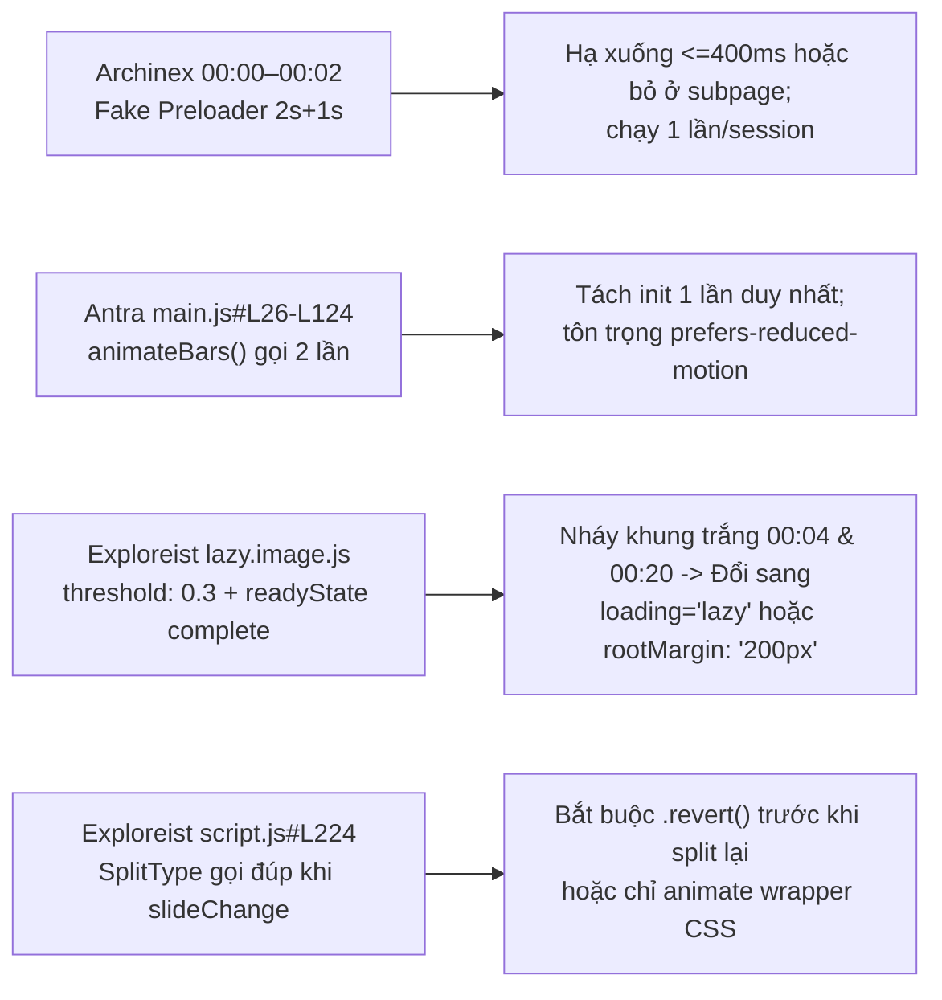

# Playbook Đợt 2 — UX/UI, Frontend & Kỹ Thuật Thực Chiến (Kiến Trúc & Editorial Du Lịch)

Tài liệu đóng gói toàn bộ bài học thiết kế, kỹ thuật Frontend, lỗi QA đã bắt qua video quay màn hình và công thức tái chế từ 3 mẫu Đợt 2 (`10_CONSTRUCTION_ARCHITECTURE` & `07_HOTEL_TRAVEL`):
1. **Mẫu 1 — `Archinex-Architecture`** ([`index.html`](file:///d:/templates/10_CONSTRUCTION_ARCHITECTURE/Archinex-Architecture/index.html), [`main.js`](file:///d:/templates/10_CONSTRUCTION_ARCHITECTURE/Archinex-Architecture/assets/js/main.js))
2. **Mẫu 2 — `Antra-Architecture-Interior`** ([`index.html`](file:///d:/templates/10_CONSTRUCTION_ARCHITECTURE/Antra-Architecture-Interior/index.html), [`portfolio.html`](file:///d:/templates/10_CONSTRUCTION_ARCHITECTURE/Antra-Architecture-Interior/portfolio.html), [`about.html`](file:///d:/templates/10_CONSTRUCTION_ARCHITECTURE/Antra-Architecture-Interior/about.html), [`main.js`](file:///d:/templates/10_CONSTRUCTION_ARCHITECTURE/Antra-Architecture-Interior/assets/js/main.js))
3. **Mẫu 3 — `Exploreist-Travel-Blog`** ([`index.html`](file:///d:/templates/07_HOTEL_TRAVEL/Exploreist-Travel-Blog/index.html), [`home-2.html`](file:///d:/templates/07_HOTEL_TRAVEL/Exploreist-Travel-Blog/home-2.html), [`script.js`](file:///d:/templates/07_HOTEL_TRAVEL/Exploreist-Travel-Blog/assets/js/script.js), [`lazy.image.js`](file:///d:/templates/07_HOTEL_TRAVEL/Exploreist-Travel-Blog/assets/js/lazy.image.js))

> [!NOTE]
> Playbook Đợt 2 bổ sung cho [Playbook Đợt 1](file:///C:/Users/Phat%20Dai/.gemini/antigravity/brain/037dc8fd-03cb-4e5a-b711-17df0d8f99a6/batch1-ui-ux-frontend-playbook.md) ở nhóm mẫu **Kiến trúc tối giản (Swiss Editorial), Tương tác không gian / Showcase (VR 360 & Before/After), và Tạp chí Bento / Dark-Light UI**.

---

## Phần 1: Bản Đồ So Sánh UI & Nhịp Điệu Thị Giác

| Trục thiết kế | Mẫu 1: `Archinex` (Kiến trúc Swiss Editorial) | Mẫu 2: `Antra` (Nội thất Luxury Interactive) | Mẫu 3: `Exploreist` (Tạp chí Du lịch Bento) | Bài học cho Dự án Web Tốt Nghiệp |
| :--- | :--- | :--- | :--- | :--- |
| **Palette & Đảo cực (Contrast Polarity)** | Giấy sáng ấm + đen mực; lật hẳn sang nền tối sâu ở `FEATURED WORK` rồi quay lại sáng ở `Our Services`; có nút `.theme-toggle` đổi luôn cả logo (`logo.svg` ↔ `logo-light.svg`, [`main.js#L2503-L2530`](file:///d:/templates/10_CONSTRUCTION_ARCHITECTURE/Archinex-Architecture/assets/js/main.js#L2503-L2530)) | Kem/trắng xen xám nhạt ở `Stages And Events` và đen tương phản mạnh ở Footer + watermark khổng lồ `antra` | Hỗ trợ Light/Dark native qua Bootstrap `data-bs-theme` + `localStorage` ([`script.js#L97-L162`](file:///d:/templates/07_HOTEL_TRAVEL/Exploreist-Travel-Blog/assets/js/script.js#L97-L162)); khóa cục bộ `data-bs-theme="light"` ở vùng category ([`home-2.html#L904`](file:///d:/templates/07_HOTEL_TRAVEL/Exploreist-Travel-Blog/home-2.html#L904)) | Nếu dùng Dark/Light toggle, học `Archinex` đổi cả SVG logo sáng/tối và học `Exploreist` dùng `data-bs-theme` để các card ảnh không bị đổi màu chữ ngoài ý muốn. |
| **Typography & Phân cấp** | Kết hợp sans-serif sắc (`maison-neue`) + `Fraunces` italic cho đánh số `(01)–(07)` và chèn pill ảnh inline ngay trong đoạn headline ([`index.html#L509-L529`](file:///d:/templates/10_CONSTRUCTION_ARCHITECTURE/Archinex-Architecture/index.html#L509-L529)) | Tiêu đề lớn chia cụm Highlight span, sub-heading chạy `SplitType` (`data-text-animation="fade-in-right"`) | Ghép `Lato` dễ đọc với font viết tay `Lovers Quarrel` / `Meddon` ([`index.html#L15`](file:///d:/templates/07_HOTEL_TRAVEL/Exploreist-Travel-Blog/index.html#L15)) tạo chất nhật ký | Inline pill image giữa dòng H2 là cách tăng cá tính editorial rất nhẹ; nhưng tuyệt đối **không đẩy lề bằng `&nbsp;`** như `home-2.html#L863` trước khi tách chữ JS. |
| **Bố cục (Layout Rhythm)** | Hero split chữ lớn + thanh metadata (`Stockholm | 1986 | Phone`) → ảnh parallax + showreel → card staggered `(01)–(07)` trên nền watermark `WORK` cố định ([`index.html#L801-L887`](file:///d:/templates/10_CONSTRUCTION_ARCHITECTURE/Archinex-Architecture/index.html#L801-L887)) | Grid 3 cột dự án + tag (`Residential`, `Single Home`) ở `portfolio.html`; `about.html` dùng `Stages And Events` carousel + ảnh isometric cutaway + 4 cột Process | `index.html`: Hero đè dải category + blog 2 cột; `home-2.html`: **Bento 1 card dọc + 2 card ngang** ([`home-2.html#L998-L1055`](file:///d:/templates/07_HOTEL_TRAVEL/Exploreist-Travel-Blog/home-2.html#L998-L1055)) + `Latest Article` 2 cột cạnh sidebar `About me` sticky | **Ưu tiên Bento 1+2 (`Exploreist home-2`) hoặc staggered lệch nhịp (`Archinex`)** thay cho grid 3 cột bằng nhau (`Antra portfolio.html`). |
| **Chi tiết định danh (Signature Touches)** | Danh sách service trỏ chuột hiện thumbnail oval bay theo chuột (`.field-thumb`) + tô màu chữ từng từ theo cuộn | Nút tiến độ cuộn `conic-gradient` đổi thành mũi tên ở `96%`; đồ chơi **360° VR (`Panolens`)** & **Before/After (`twentytwenty`)** | Thanh TOC/Sidebar tự cộng `sectionHeaderHeight` để bám sticky không bị header che | Chọn tối đa **1 Signature Move** phục vụ đúng câu chuyện dự án (ví dụ Before/After cho cải tạo/so sánh hoặc Bento sticky reader cho content). |

---

## Phần 2: Kho Kỹ Thuật Frontend Thực Chiến Từ Đợt 2

### 1. Custom Cursor Lerp Cập Nhật Qua CSS Custom Properties (`rAF`)
- **Nguồn:** `Antra` `customCursor` — [`main.js#L261-L335`](file:///d:/templates/10_CONSTRUCTION_ARCHITECTURE/Antra-Architecture-Interior/assets/js/main.js#L261-L335).
- **Cơ chế hay:** Chạy vòng lặp `requestAnimationFrame` với 2 hệ số trễ khác nhau (`0.35` cho chấm nhỏ `.mt-cursor` và `0.18` cho vòng tròn `.mt-cursor-view`), rồi chỉ ghi vào biến CSS `--tl-cx`, `--tl-cy`, `--tl-vx`, `--tl-vy`. Kết hợp được với `destroyCustomCursor()` để dọn sạch listener.
- **Mẹo nâng cấp cho dự án thật:** Bọc toàn bộ trong `@media (hover: hover) and (pointer: fine)` và gắn thêm re-hit-test khi `scroll` (như bài học từ Đợt 1) để badge `View` không bị treo khi cuộn bánh xe.

```css
@media (hover: hover) and (pointer: fine) {
  .custom-cursor-badge {
    position: fixed;
    top: 0;
    left: 0;
    transform: translate3d(var(--vx, -100px), var(--vy, -100px), 0) translate(-50%, -50%);
    pointer-events: none;
    will-change: transform;
  }
}
```

### 2. Nút Progress Cuộn + Back-to-Top 2 Trong 1 Bằng `conic-gradient` / SVG Dashoffset
- **So sánh 2 cách làm đẹp trong Đợt 2:**
  - `Antra` ([`main.js#L1549-L1592`](file:///d:/templates/10_CONSTRUCTION_ARCHITECTURE/Antra-Architecture-Interior/assets/js/main.js#L1549-L1592)): Dùng `conic-gradient(..., ${scrollValue}%)` vẽ vòng tròn tiến độ không cần SVG, hiện `%` ở giữa và tự chuyển thành icon mũi tên khi `scrollValue >= 96`.
  - `Archinex` ([`main.js#L215-L287`](file:///d:/templates/10_CONSTRUCTION_ARCHITECTURE/Archinex-Architecture/assets/js/main.js#L215-L287)): Dùng SVG `<path>` + `getTotalLength()` / `strokeDashoffset`, đồng thời trên mobile (`max-width: 991px`) **chỉ hiện nút khi user cuộn ngược lên** (`currentScroll < lastScrollTop`) — UX rất tinh tế để không chắn nội dung đọc trên màn hình nhỏ.
- **Công thức vá an toàn (tránh chia `0` và không ghi đè `window.onscroll`):**

```js
window.addEventListener("scroll", () => {
  const maxScroll = document.documentElement.scrollHeight - document.documentElement.clientHeight;
  const pct = maxScroll > 0 ? Math.min(100, Math.round((window.scrollY / maxScroll) * 100)) : 0;
  ringEl.style.setProperty("--scroll-pct", `${pct}%`);
  labelEl.dataset.complete = pct >= 96 ? "true" : "false";
}, { passive: true });
```

### 3. Floating Preview Theo Chuột Trong Danh Sách Dịch Vụ (`.field__single .field-thumb`)
- **Nguồn:** `Archinex` — [`main.js#L424-L452`](file:///d:/templates/10_CONSTRUCTION_ARCHITECTURE/Archinex-Architecture/assets/js/main.js#L424-L452) (khung danh sách `Our Services` ở `00:19–00:21` video 1).
- **Cơ chế:** Chỉ bật khi `device_width > 576`; mỗi hàng dịch vụ tính tọa độ tương đối `event.clientX - rect.left`, `event.clientY - rect.top` rồi lerp (`0.1`) `transform: translate(currentX, currentY) translate(-50%, -50%)`.
- **Nâng cấp production:** Thay vòng `rAF` chạy vô tận cho từng row ngay từ lúc tải trang bằng cơ chế chỉ chạy `rAF` khi hàng đang `:hover` / `mouseenter`, và dừng `cancelAnimationFrame` lúc `mouseleave` để tiết kiệm CPU.

### 4. Declarative Text & Hover Engine (`[data-text-animation]` & `featureHoverGSAP`)
- **Nguồn:** `Antra` — [`main.js#L364-L487`](file:///d:/templates/10_CONSTRUCTION_ARCHITECTURE/Antra-Architecture-Interior/assets/js/main.js#L364-L487) (`featureHoverGSAP`) và [`main.js#L1160-L1336`](file:///d:/templates/10_CONSTRUCTION_ARCHITECTURE/Antra-Architecture-Interior/assets/js/main.js#L1160-L1336) (`[data-text-animation]`).
- **Điểm hay:**
  - `featureHoverGSAP` viết 1 helper cấu hình bằng selector (`container`, `image`, `text`, `trigger`) dùng lại cho 4 khu vực khác nhau (`.feature-item`, `.team-item`, `.award-item`, `.service-item-7`), hỗ trợ cả hover lẫn `data-mode="click"`.
  - `[data-text-animation]` gắn kiểu hiệu ứng qua HTML attribute (`slide-up`, `fade-in-right`, `scrub`, v.v.) và bật `ScrollSmoother` có điều kiện qua `gsap.matchMedia().add("(min-width: 768px)", ...)` ([`main.js#L1605-L1620`](file:///d:/templates/10_CONSTRUCTION_ARCHITECTURE/Antra-Architecture-Interior/assets/js/main.js#L1605-L1620)).

### 5. Tô Màu Từng Từ Theo Nhịp Cuộn (`title-animation-color`) & Split Chờ Fonts Ready
- **Nguồn:** `Archinex` — [`main.js#L2374-L2474`](file:///d:/templates/10_CONSTRUCTION_ARCHITECTURE/Archinex-Architecture/assets/js/main.js#L2374-L2474).
- **Điểm đáng học nhất:** Bọc `document.fonts.ready.then(...)` trước khi đo/tách dòng để font web không làm nhảy chiều cao dòng sau khi split, và đọc màu đích trực tiếp từ biến CSS `getComputedStyle(el).getPropertyValue("--char-active")` để đồng bộ tốt với Dark/Light mode.

### 6. Kho Tương Tác Nâng Cao Có Sẵn Trong `Antra` (Không Hiện Trong Clip Nhưng Rất Hợp Làm Điểm Nhấn)
- **360° VR Panorama (`Three.js` + `Panolens.js`):** [`main.js#L109-L117`](file:///d:/templates/10_CONSTRUCTION_ARCHITECTURE/Antra-Architecture-Interior/assets/js/main.js#L109-L117) (`.antra-panoroma-img`).
- **Before / After Comparison Slider (`twentytwenty`):** [`main.js#L128-L135`](file:///d:/templates/10_CONSTRUCTION_ARCHITECTURE/Antra-Architecture-Interior/assets/js/main.js#L128-L135) (`.antra-image-comparison`, hỗ trợ kéo & hover).
- **Sticky Động Chống Đè Header:** [`Exploreist script.js#L69-L88`](file:///d:/templates/07_HOTEL_TRAVEL/Exploreist-Travel-Blog/assets/js/script.js#L69-L88) cộng trực tiếp `sectionHeaderHeight + 30px` vào `top` của sidebar bám dính.

---

## Phần 3: Nhật Ký Lỗi UX/UI & Kỹ Thuật Đã Bắt Qua Video Đợt 2



### Checklist Lỗi Tuyệt Đối Không Lặp Lại Ở Dự Án Tốt Nghiệp

1. **Bẫy Lazy-Load gây chớp khung trắng khi cuộn (`Exploreist` `00:00`, `00:04–00:05`, `00:20–00:21`):**
   - [`lazy.image.js#L1-L38`](file:///d:/templates/07_HOTEL_TRAVEL/Exploreist-Travel-Blog/assets/js/lazy.image.js#L1-L38) đợi toàn trang `readyState === 'complete'` mới quan sát ảnh, lại đặt `rootMargin: '0px'` + `threshold: 0.3` kết hợp `wow fadeInUp` nên user thấy nguyên hộp xám `placeholder.svg` bật chớp trước mắt.
   - **Cách vá:** Dùng native `` kèm `aspect-ratio` cố định để giữ chỗ không giật layout (CLS = 0).

2. **Preloader chạy giả lập & gọi đúp chặn chuyển trang (`Archinex` `00:00`, `Antra` `00:00` & `00:21`):**
   - `Archinex` [`main.js#L2476-L2493`](file:///d:/templates/10_CONSTRUCTION_ARCHITECTURE/Archinex-Architecture/assets/js/main.js#L2476-L2493) chạy tween giả `0 -> 100%` cố định `2s` + `1s` kéo rèm (`3s` chết trước khi mở chữ Hero).
   - `Antra` [`main.js#L26-L124`](file:///d:/templates/10_CONSTRUCTION_ARCHITECTURE/Antra-Architecture-Interior/assets/js/main.js#L26-L124) gọi `animateBars()` **2 lần** (một lần chạy thẳng ở dòng `#L106`, một lần nữa trong `$(window).on("load")` ở `#L120`), kèm `.preloader.remove()` cứng sau `3000ms` và chạy lại mỗi lần bấm sang trang con `about.html`.

3. **Lẫn lộn/Nạp trùng thư viện & Bug logic JS âm thầm:**
   - **Nạp trùng thư viện (`Exploreist` [`index.html#L1675-L1683`](file:///d:/templates/07_HOTEL_TRAVEL/Exploreist-Travel-Blog/index.html#L1675-L1683)):** Kéo cả `Swiper` lẫn `Owl Carousel`, cả GSAP `SplitText` lẫn `SplitType`; trong [`script.js#L224-L245`](file:///d:/templates/07_HOTEL_TRAVEL/Exploreist-Travel-Blog/assets/js/script.js#L224-L245) lại gọi `new SplitType(...)` mỗi lần `hero-slider` đổi slide mà không `.revert()`.
   - **Đấu ngược nút Carousel (`Antra` [`main.js#L634-L637`](file:///d:/templates/10_CONSTRUCTION_ARCHITECTURE/Antra-Architecture-Interior/assets/js/main.js#L634-L637)):** `nextEl` trỏ nhầm vào `.swiper-prev` và `prevEl` trỏ vào `.swiper-next` ở nhiều carousel (`gallary-carousel`, `testi-carousel`, `testi-carousel-5`).
   - **Biến không dùng / Event đè / Global DOM ID:** `Antra` đọc `data-delay` ở `#L1195-L1197` nhưng không truyền vào timeline, và gán trực tiếp `window.onscroll = ...` ở `#L1578`; `Exploreist` gọi `$('.back-to-top')` thừa (`#L63`) và gọi `next.click()` theo global ID (`#L545`, `#L568`).

4. **Lỗi nội dung Copy-Paste & Link hỏng (Template Smells):**
   - `Archinex`: Link con không có `.html` (`about-us`, `our-services`, `project-details` — di sản scrape Netlify ở [`index.html#L6-L8`](file:///d:/templates/10_CONSTRUCTION_ARCHITECTURE/Archinex-Architecture/index.html#L6-L8)), giữ `logoipsum`, lặp mô tả `"We work in existing and new building, sometimes temporary."` ở danh sách service.
   - `Antra`: Trùng tiêu đề/địa điểm card 4–9 ở [`portfolio.html#L287-L345`](file:///d:/templates/10_CONSTRUCTION_ARCHITECTURE/Antra-Architecture-Interior/portfolio.html#L287-L345); lặp `2025` & mô tả ở `history-carousel`; cả 4 bước quy trình [`about.html#L448-L485`](file:///d:/templates/10_CONSTRUCTION_ARCHITECTURE/Antra-Architecture-Interior/about.html#L448-L485) dùng chung 1 đoạn mô tả; lỗi chữ `"Start your’s today"` (`#L492`), `"Owr clients say"` (`#L627`) và còn sót `Lorem ipsum` (`#L581`).
   - `Exploreist`: Nhãn `"camping 1"` ([`index.html#L905`](file:///d:/templates/07_HOTEL_TRAVEL/Exploreist-Travel-Blog/index.html#L905)), `"Your Adventure begin here"` thiếu `s` (`#L864`), tiêu đề trỏ `href="index.html#"` (`#L1252-L1273`), ảnh bài viết link nhầm sang `about-1.html` ([`home-2.html#L1162`](file:///d:/templates/07_HOTEL_TRAVEL/Exploreist-Travel-Blog/home-2.html#L1162), [`#L1209`](file:///d:/templates/07_HOTEL_TRAVEL/Exploreist-Travel-Blog/home-2.html#L1209)), copy nhầm mô tả giữa các bài (`#L1153`, `#L1246`), dùng `<span>&nbsp; &nbsp; &nbsp; &nbsp;</span>` căn lề (`#L863`).

---

## Phần 4: Gợi Ý Ráp Vào Dự Án Web Tốt Nghiệp

| Mục tiêu trang trong Dự án Tốt nghiệp | Bốc kỹ thuật từ Đợt 2 | Ràng buộc khi áp dụng |
| :--- | :--- | :--- |
| **Trang Giới Thiệu / Studio / Kiến Trúc** | • Headline kẹp pill ảnh inline + cặp font sans/serif italic (`Archinex`)<br>• Danh sách dịch vụ hover hiện thumbnail lerp (`Archinex` `.field-thumb`)<br>• Số đếm + ảnh isometric / Before-After slider (`Antra`) | Không dùng preloader 3 giây; tắt hover thumbnail trên touch device; viết copy khác nhau cho từng bước quy trình. |
| **Trang Tin Tức / Blog / Cẩm Nang** | • Bento `1 cao + 2 ngang` cho bài nổi bật (`Exploreist home-2`)<br>• Sidebar sticky tự bù chiều cao Header (`Exploreist`)<br>• Nút Progress Ring 2-trong-1 (`Antra` `conic-gradient` hoặc `Archinex` SVG smart mobile) | Bắt buộc dùng `` + `aspect-ratio`, bỏ `WOW.js` + `threshold: 0.3` để loại hoàn toàn hiện tượng nháy ảnh xám. |
| **Hệ thống Theme & Motion Toàn Cục** | • `data-bs-theme` + `localStorage` + đổi cả SVG logo sáng/tối (`Exploreist` + `Archinex`)<br>• `gsap.matchMedia()` cho desktop smooth scroll (`Antra`)<br>• `document.fonts.ready` trước khi tách dòng text (`Archinex`) | Chỉ chọn 1 thư viện carousel (`Swiper`) và 1 cách tách chữ (`SplitType` miễn phí hoặc helper DOM Đợt 1 có `.revert()`). |
